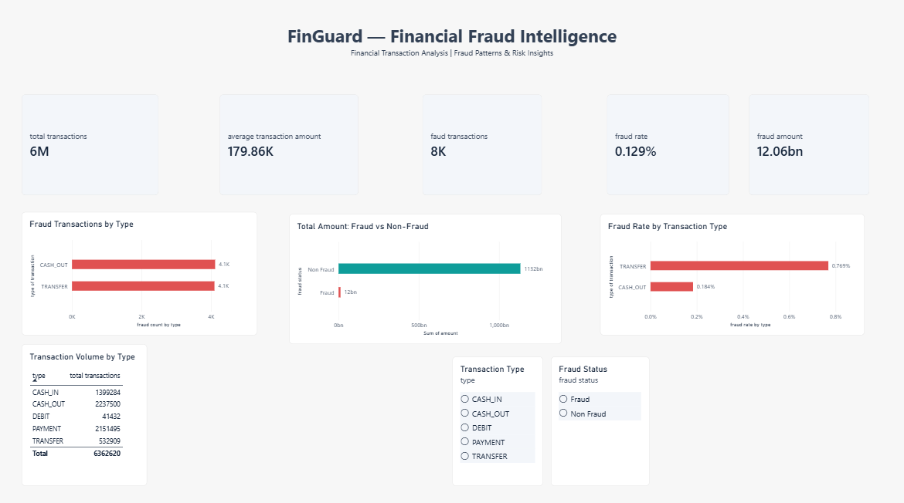
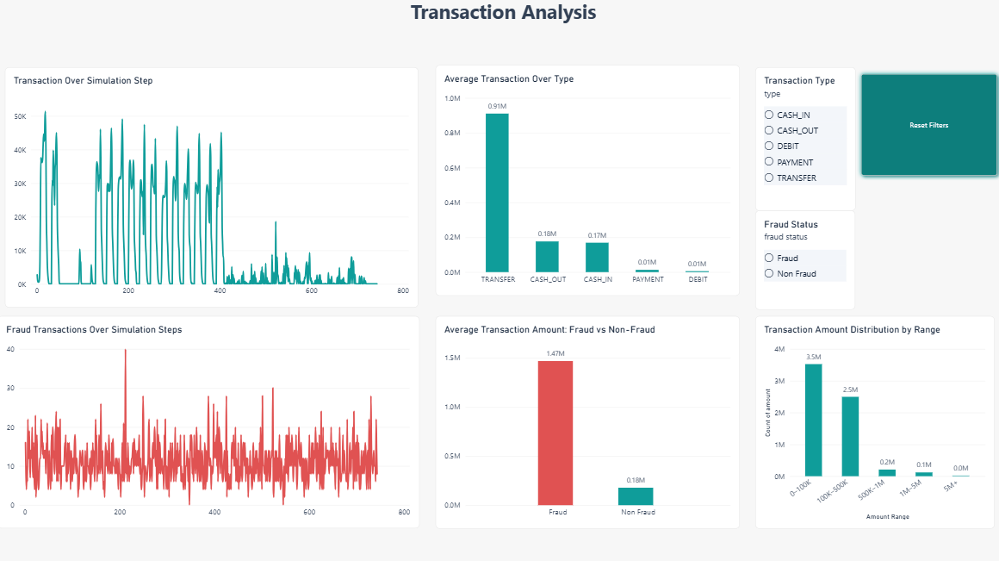
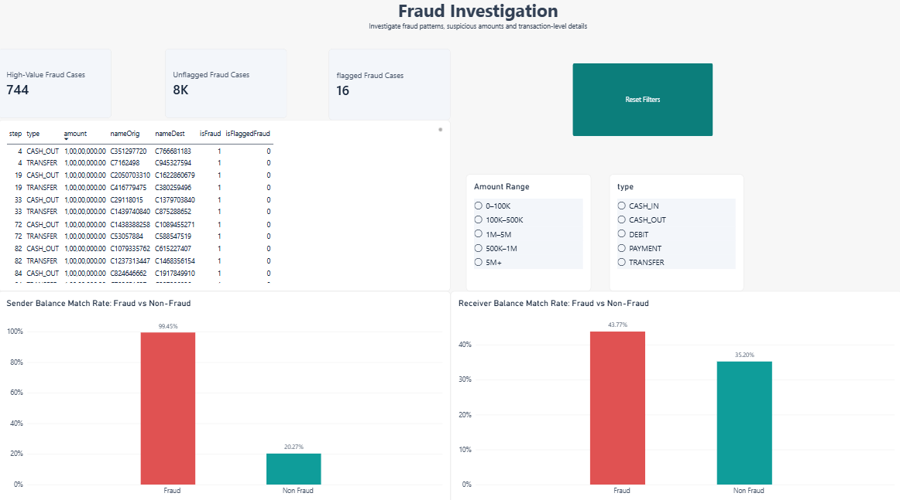
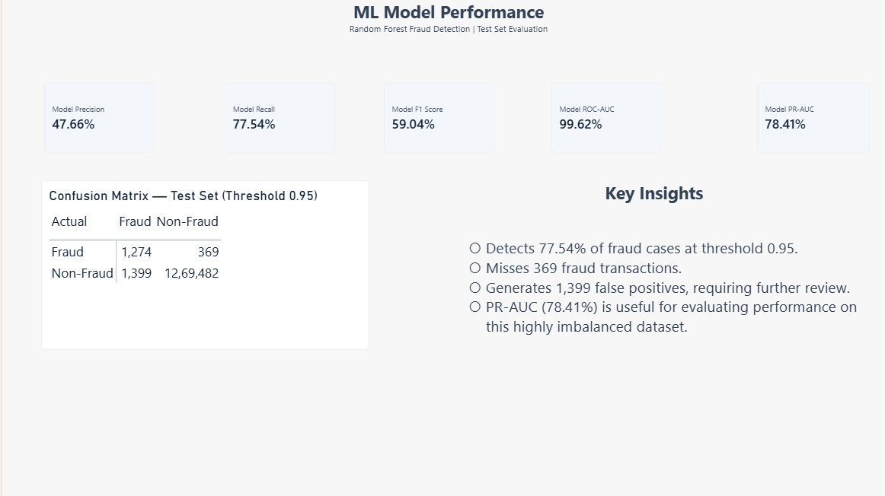
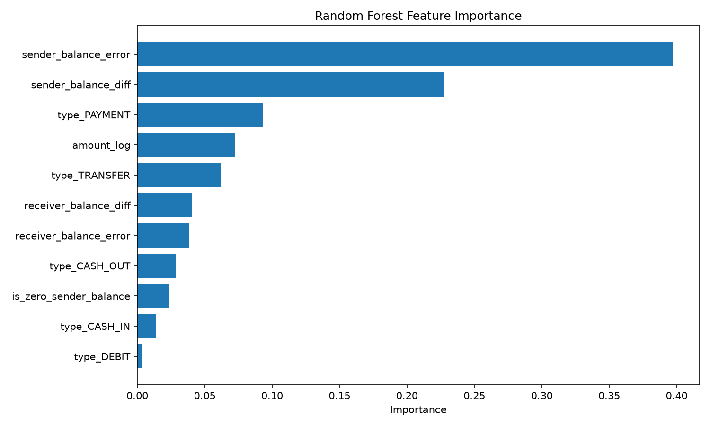

# FinGuard Pro — Financial Transaction & Fraud Intelligence

An end-to-end data analytics and machine learning project for analyzing financial transactions, identifying suspicious activity, and communicating insights through SQL, Python, Power BI, and Streamlit.

## Project Overview

FinGuard Pro analyzes financial transaction data to understand transaction patterns, investigate fraud-related behavior, and evaluate a machine learning model for fraud detection.

The project combines data cleaning and feature engineering, SQL-based analytics, machine learning evaluation, an interactive Power BI report, and a Streamlit application for transaction-level risk scoring.

**Key objectives**
- Analyze large-scale financial transaction data.
- Identify patterns associated with fraudulent transactions.
- Investigate transaction types, amounts, and account balance changes.
- Evaluate fraud detection performance using appropriate classification metrics.
- Present analytical findings through interactive dashboards.
- Generate risk estimates for uploaded transaction CSV files.

## Technology Stack

- **Programming:** Python
- **Data Analysis:** Pandas, NumPy
- **Database:** MySQL
- **Machine Learning:** Scikit-learn, Random Forest
- **Model Storage:** Joblib
- **Visualization & BI:** Power BI, Matplotlib
- **Interactive Application:** Streamlit
- **Development Tools:** VS Code, Git, GitHub

## Dataset

This project uses the PaySim synthetic mobile-money transaction dataset.

The complete dataset contains **6,362,620 transactions** and 11 original columns.

| Dataset characteristic | Value |
|---|---:|
| Total transactions | 6,362,620 |
| Fraudulent transactions | 8,213 |
| Non-fraudulent transactions | 6,354,407 |
| Fraud rate | Approximately 0.1291% |
| Transaction types | 5 |

The original transaction types are `CASH_IN`, `CASH_OUT`, `DEBIT`, `PAYMENT`, and `TRANSFER`.

The dataset is highly imbalanced, meaning fraudulent transactions represent a very small proportion of all transactions. This makes precision, recall, F1-score, and Precision-Recall AUC important evaluation measures.

The dataset is synthetic. Results should not be interpreted as evidence of real-world fraud detection performance.

**Dataset source:** [PaySim — Financial Mobile Money Simulator](https://www.kaggle.com/datasets/ealaxi/paysim1)

Download the dataset separately and place the original CSV in `data/raw/` using the filename expected by the feature-engineering script.

## Project Workflow

1. **Data auditing and exploration:** Examine transaction counts, amounts, fraud labels, and transaction types.
2. **Feature engineering:** Calculate sender balance changes, receiver balance changes, balance discrepancies, zero-balance indicators, and log-transformed transaction amounts.
3. **SQL analytics:** Analyze transaction patterns and fraud-related statistics using MySQL.
4. **Machine learning:** Train a Random Forest classifier using engineered transaction features.
5. **Model evaluation:** Select a decision threshold using validation data and evaluate the final model on held-out test data.
6. **Power BI reporting:** Build interactive reports for fraud overview, transaction analysis, fraud investigation, and model performance.
7. **Streamlit application:** Upload a transaction CSV, calculate fraud-risk probabilities, categorize predictions, and download the results.

## Machine Learning

The project uses a Random Forest classifier trained on engineered transaction features.

The model uses six numerical features and five one-hot-encoded transaction-type features:

- Sender balance difference
- Receiver balance difference
- Sender balance error
- Receiver balance error
- Zero sender balance indicator
- Log-transformed transaction amount
- Transaction type indicators

The training configuration includes 150 trees, a maximum depth of 16, a minimum leaf size of 5, and balanced class weights.

The dataset is split into development and test subsets. The development subset is further divided into training and validation subsets. The validation set is used for threshold selection, while the held-out test set is used for final evaluation.

### Final Test Results

The following metrics were obtained at a classification threshold of 0.95.

| Metric | Result |
|---|---:|
| Precision | 47.66% |
| Recall | 77.54% |
| F1-score | 59.04% |
| PR-AUC (Average Precision) | 78.41% |
| ROC-AUC | 99.62% |
| Test transactions | 1,272,524 |

### Confusion Matrix

| Actual class | Predicted fraud | Predicted non-fraud |
|---|---:|---:|
| Fraud | 1,274 | 369 |
| Non-fraud | 1,399 | 1,269,482 |

**Interpretation**

- The model correctly identified 1,274 fraudulent transactions.
- It missed 369 actual fraud cases.
- It incorrectly flagged 1,399 non-fraudulent transactions.
- Fraud recall was 77.54%, while fraud precision was 47.66%.

Although ROC-AUC was high, the minority-class results and false-positive count remain important considerations. The decision threshold represents a trade-off between catching fraudulent transactions and generating false alarms.

These results are specific to the synthetic dataset and evaluation setup.

## Power BI Dashboard

### 1. Fraud Overview


### 2. Transaction Analysis


### 3. Fraud Investigation


### 4. Model Performance


### Feature Importance


### 1. Fraud Overview
Summarizes transaction volume, fraud counts, fraud rates, transaction amounts, and fraud distribution by transaction type.

### 2. Transaction Analysis
Explores transaction patterns across simulation steps, average transaction amounts, fraud versus non-fraud amounts, and transaction amount ranges.

### 3. Fraud Investigation
Provides a fraud-focused transaction table, high-value fraud summaries, flagged versus unflagged cases, and sender/receiver balance-change comparisons.

### 4. Model Performance
Presents classification metrics, a confusion matrix, and key model evaluation findings.

The dataset's `step` column represents a simulation step, not a calendar date or actual transaction timestamp.

## Streamlit Fraud-Risk Application

The Streamlit application allows users to upload a CSV containing transaction data and obtain model-based fraud-risk estimates.

**Application features**
- CSV upload and input validation
- Feature engineering consistent with model training
- Random Forest probability scoring
- High Risk, Review, and Low Risk categories
- Transaction-level prediction results
- Downloadable prediction CSV

### Risk Classification

| Predicted fraud probability | Category |
|---|---|
| 95% or higher | High Risk |
| 50% to below 95% | Review |
| Below 50% | Low Risk |

These categories are operational rules applied to model probabilities. They do not establish whether a transaction is genuinely fraudulent.

## Project Structure

The repository is organized into data, source code, SQL analytics, notebooks, model artifacts, reports, and the dashboard application.

```text
FinGuard/
├── data/
│   ├── raw/
│   └── processed/
├── notebooks/
├── src/
├── sql/
├── models/
│   └── random_forest_final.joblib
├── reports/
├── dashboard/
│   └── app.py
├── README.md
└── requirements.txt
```

The structure above illustrates the main project components. Keep the paths consistent with the actual files in your repository.

## Installation and Setup

### Prerequisites
- Python 3.11 or another compatible Python version
- Git
- MySQL Server and MySQL Workbench for SQL analysis
- Power BI Desktop for viewing or editing the report

### 1. Clone the repository

```bash
git clone https://github.com/kristyrajput/finguard
cd FinGuard
```

Replace the placeholder with your actual repository URL.

### 2. Create a virtual environment

```bash
python -m venv .venv
```

Activate it on Windows:

```powershell
.venv\Scripts\Activate.ps1
```

### 3. Install dependencies

```bash
python -m pip install pandas numpy scikit-learn joblib streamlit matplotlib
```

If the repository includes a `requirements.txt` file, use:

```bash
python -m pip install -r requirements.txt
```

### 4. Prepare the data

Download the PaySim dataset separately and place the original CSV in the location expected by the project scripts.

Run feature engineering before model training if the processed feature files are not already available. The exact commands depend on the script filenames in the repository.

### 5. Run the Streamlit application

From the project root:

```bash
python -m streamlit run dashboard/app.py
```

Upload a CSV containing the required original transaction columns:

`type`, `amount`, `oldbalanceOrg`, `newbalanceOrig`, `oldbalanceDest`, and `newbalanceDest`.

The application uses the saved model at `models/random_forest_final.joblib`.

### 6. Explore the Power BI report

Open the Power BI `.pbix` report in Power BI Desktop. If the report is not included in the repository, add its actual location and access instructions here.

## Limitations

- PaySim is synthetic data and may not represent the complexity of real financial fraud.
- Fraud cases are highly imbalanced relative to non-fraud transactions.
- A high predicted probability is not proof of fraud.
- The chosen threshold affects precision, recall, and the number of false alarms.
- The Streamlit application provides risk estimates for review; it is not a production fraud prevention or transaction-blocking system.
- The reported evaluation metrics should not be generalized to unseen real-world financial systems without further validation.

## Future Improvements

- Add more robust input validation and automated tests.
- Compare alternative models and threshold-selection strategies.
- Add explainability using feature importance or SHAP.
- Evaluate model performance on additional datasets.
- Improve model monitoring and drift analysis.
- Deploy the application with appropriate security and data-protection controls.


---

*FinGuard Pro is an educational data analytics and machine learning project demonstrating an end-to-end workflow for financial transaction analysis and fraud-risk scoring.*